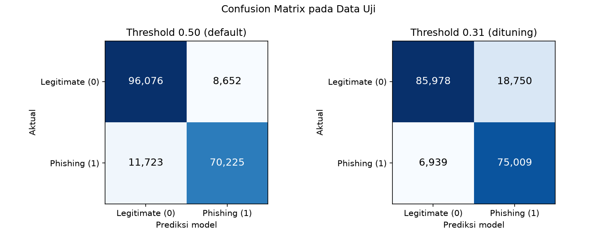

# Deteksi URL Phishing berbasis Machine Learning

Aplikasi web (Streamlit) yang menilai apakah sebuah URL berisiko phishing. Model Random Forest dilatih
pada ratusan ribu URL berlabel dan membaca **pola struktur URL** (heuristik berbasis fitur), bukan
sekadar *blacklist* statis, sehingga bisa menilai tautan yang belum pernah terlihat sebelumnya.

**Teknologi:** Python · scikit-learn · pandas · Streamlit · matplotlib

**Dibuat oleh:** `Ahmad Faris Maulana` (pipeline ML & data) dan `Graciella Vaniaputri Budiono` (aplikasi & pengujian)

## Latar belakang

Phishing mencuri kredensial (username, password, PIN, OTP) lewat tautan palsu yang menyerupai situs
resmi. Dalam segitiga CIA, ancaman ini terutama menyerang:

- **Confidentiality**: kredensial dan data pribadi bocor ke penyerang.
- **Integrity**: akun yang diambil alih dipakai untuk mengubah data secara tidak sah.

Aplikasi ini membantu pengguna memeriksa sebuah URL **sebelum** membukanya.

| | |
|---|---|
| **Pengguna sasaran** | Pengguna umum yang menerima tautan mencurigakan (SMS, email, pesan instan) |
| **Input** | Satu URL (teks) |
| **Output** | Status (Aman / Phishing), skor risiko (%), rincian fitur URL, dan saran tindakan |

## Dataset

- **Sumber:** [`ealvaradob/phishing-dataset`](https://huggingface.co/datasets/ealvaradob/phishing-dataset) (Hugging Face), file `urls.json`.
- **Label:** `0` = Legitimate (aman), `1` = Phishing.
- **Isi:** kolom `text` (URL) dan `label`.
- **Jumlah data:** lihat bagian pembersihan di `reports/training_log.txt` (jumlah mentah, duplikat dan label bertentangan yang dibuang, serta jumlah akhir).
- Dataset **tidak disertakan** di repositori (ukurannya besar). Unduh `urls.json` dari tautan di atas dan taruh di folder utama proyek.

Hanya string URL yang diproses. Tidak ada situs yang dikunjungi dan tidak ada berkas berbahaya yang dijalankan.

## Cara menjalankan

Contoh di bawah untuk Linux dengan shell **fish** (di bash/zsh gunakan `source venv/bin/activate`).

```fish
python -m venv venv
source venv/bin/activate.fish
pip install -r requirements.txt
```

**1. Latih model** (letakkan `urls.json` di folder ini terlebih dulu):

```fish
python train_model.py --sample 100000          # uji cepat (~1 menit)
mkdir -p reports
python -u train_model.py | tee reports/training_log.txt   # data penuh (beberapa menit)
```

Opsi: `--data PATH` (lokasi dataset), `--sample N`, `--folds K`, `--beta B` (bobot recall saat memilih threshold; default 1.5).

**2. Jalankan aplikasi:**

```fish
streamlit run app.py
```

Model terlatih sudah disertakan di folder `models/`, jadi langkah 1 hanya perlu diulang jika Anda ingin melatih ulang.

## Struktur folder

```
.
├── utils.py            # normalisasi URL, validasi input, ekstraksi 16 fitur (dipakai training & aplikasi)
├── train_model.py      # pembersihan data, EDA, validasi silang, pelatihan, evaluasi, analisis kesalahan
├── app.py              # antarmuka Streamlit
├── models/
│   ├── phishing_model.pkl   # model terlatih
│   ├── scaler.pkl           # StandardScaler (fit hanya pada data latih)
│   └── config.json          # threshold keputusan, nama model, daftar fitur
├── reports/            # confusion matrix, EDA, importance fitur, analisis kesalahan, metrik, log training
├── requirements.txt
└── README.md
```

## Metode

### Alur training (`train_model.py`)

1. **Muat dan bersihkan data.** Buang data kosong, duplikat, dan URL berlabel bertentangan. Duplikat dicek pada URL yang sudah dinormalisasi.
2. **EDA ringkas.** Distribusi kelas, bias skema URL, dan statistik fitur per kelas (disimpan di `reports/`).
3. **Ekstraksi fitur** lewat `utils.py`.
4. **Split data uji 20% berdasarkan domain.** Domain yang sama tidak boleh ada di data latih dan data uji sekaligus (skrip memeriksa irisannya = 0).
5. **Validasi silang `GroupKFold`** pada data latih untuk membandingkan model dan memilih threshold. Scaler di-fit ulang di setiap lipatan lewat `Pipeline`.
6. **Model akhir.** Scaler dan model hanya di-fit pada data latih. Data uji dipakai satu kali untuk evaluasi akhir.
7. **Analisis kesalahan.** URL False Positive dan False Negative disimpan ke `reports/error_analysis.csv`.

### Fitur (16, dari `utils.py`)

| Kelompok | Fitur |
|---|---|
| Panjang | `url_length`, `domain_length`, `path_length` |
| Karakter khusus | `count_at`, `count_hyphen`, `count_dot`, `count_slash`, `count_question`, `count_equal` |
| Host | `has_ip`, `is_shortened`, `subdomain_count`, `host_digit_count` |
| Konten | `has_sensitive_word` (login, verify, account, update, bank, secure, ...), `digit_ratio`, `url_entropy` |

### Catatan desain

- **URL dinormalisasi sebelum fitur dihitung** (tanpa `http(s)://` dan `www.`), dan fitur `is_https` tidak dipakai. Di dataset ini sekitar 44% URL phishing ditulis dengan skema, dibanding sekitar 10% URL aman (untuk `https`: sekitar 29% vs 5%). Itu artefak pencatatan data. Jika dipakai, model belajar "ada skema = phishing" dan bukan ciri phishing yang sebenarnya.
- **Split per domain** karena banyak URL berasal dari domain atau kampanye yang sama. Split acak membuat model "menghafal" domain dan skor uji menjadi terlalu optimis.
- **Threshold bukan 0,5.** Karena False Negative (phishing lolos) lebih berbahaya daripada False Positive, threshold dipilih pada data validasi dengan memaksimalkan F-beta (beta = 1,5) agar recall naik. Nilainya tersimpan di `models/config.json`, dan aplikasi membacanya dari sana. Konsekuensinya lebih banyak URL aman yang ikut ditandai.
- **Model:** Random Forest dibandingkan dengan Logistic Regression (dan XGBoost bila terpasang) lewat validasi silang. Model dengan F1 terbaik dipilih otomatis. Hasil perbandingan ada di `reports/cv_model_comparison.csv`.

### Hasil

Metrik dihitung pada data uji (dipisah per domain, 186.676 URL, 81.948 di antaranya phishing) untuk kelas phishing.

| Threshold | Accuracy | Precision | Recall | F1 | FN | FP |
|---|---|---|---|---|---|---|
| 0,50 | 89,1% | 89,0% | 85,7% | 87,3% | 11.723 | 8.652 |
| 0,31 (dipakai aplikasi) | 86,2% | 80,0% | 91,5% | 85,4% | 6.939 | 18.750 |

Dengan threshold 0,31, phishing yang lolos turun dari sekitar 14,3% menjadi sekitar 8,5%. Harganya, sekitar 17,9% URL aman ikut ditandai (naik dari 8,3%).



Pembahasan kesalahan: `reports/error_analysis.csv`.

## Keterbatasan

- Fitur hanya berasal dari **teks URL**. Model tidak melihat usia domain, WHOIS, sertifikat, atau isi halaman.
- URL berisi domain saja (tanpa path) sulit dibedakan secara struktural, sehingga muncul False Positive.
- Phishing yang di-host di situs sah yang diretas bisa tampak normal dan lolos (False Negative).
- Platform hosting gratis (blog, subdomain gratis) bisa berisi konten aman maupun phishing, sehingga ambigu.
- Hasil adalah **estimasi risiko**, bukan kepastian. Jangan dijadikan satu-satunya dasar keputusan.

## Penggunaan bantuan AI

Bantuan AI (Claude, Anthropic) digunakan untuk meninjau rancangan fitur dan pipeline, menemukan masalah
pada versi awal (bias skema URL, kebocoran domain antar split), dan menyusun ulang `utils.py` serta
`train_model.py`. Kode telah dijalankan dan dipahami oleh anggota tim. `[Sesuaikan dengan penggunaan sebenarnya, termasuk untuk app.py dan laporan.]`

## Referensi

- Dataset: [ealvaradob/phishing-dataset](https://huggingface.co/datasets/ealvaradob/phishing-dataset)
- Pustaka: scikit-learn, pandas, numpy, matplotlib, joblib, Streamlit
